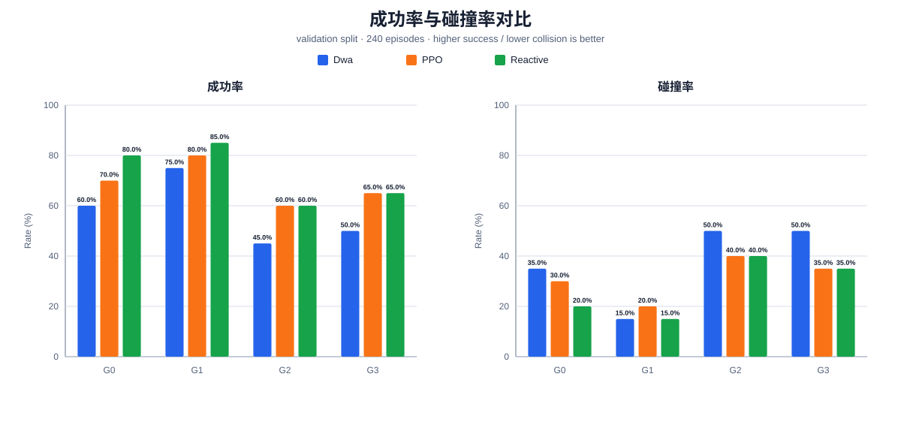
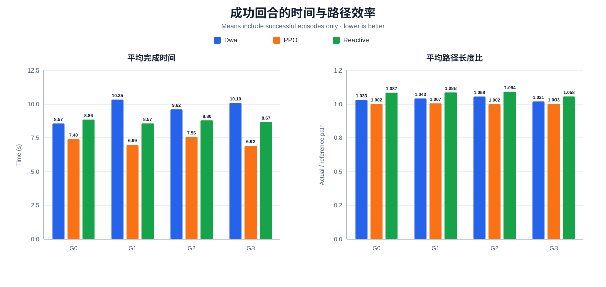

# 运动学验证集基准报告

- 数据划分：`validation`（验证集结果不可代替最终 Webots 物理仿真测试）
- 总回合数：240
- 规划器：`dwa`, `ppo`, `reactive`
- 工况：`G0`, `G1`, `G2`, `G3`
- 生成命令：`.venv/bin/python scripts/plot_benchmark.py --input-dir artifacts/results/kinematic_validation_retrained_20260830`

## 总体指标

| 规划器 | 回合 | 成功率 | 碰撞率 | 超时率 | 完成时间¹ (s) | 路径长度比¹ | 最小间隙² (m) | 近碰撞占比² | 动作变化平方² | 推理 P95² (ms) |
|---|---:|---:|---:|---:|---:|---:|---:|---:|---:|---:|
| dwa | 80 | 57.5% | 37.5% | 5.0% | 9.69 | 1.039 | 0.311 | 4.0% | 0.0055 | 7.088 |
| ppo | 80 | 76.2% | 23.8% | 0.0% | 7.10 | 1.010 | 0.360 | 5.9% | 0.0672 | 0.386 |
| reactive | 80 | 72.5% | 27.5% | 0.0% | 8.72 | 1.082 | 0.315 | 4.9% | 0.0264 | 0.027 |

¹ 仅统计成功到达的回合；² 统计该规划器的全部回合。路径长度比 = 实际路径长度 / 起终点直线参考长度。

## 分工况指标

| 工况 | 规划器 | 回合 | 成功率 | 碰撞率 | 超时率 | 完成时间¹ (s) | 路径长度比¹ | 最小间隙² (m) |
|---|---|---:|---:|---:|---:|---:|---:|---:|
| G0 | dwa | 20 | 60.0% | 35.0% | 5.0% | 8.57 | 1.033 | 0.325 |
| G0 | ppo | 20 | 90.0% | 10.0% | 0.0% | 7.32 | 1.014 | 0.384 |
| G0 | reactive | 20 | 80.0% | 20.0% | 0.0% | 8.86 | 1.087 | 0.316 |
| G1 | dwa | 20 | 75.0% | 15.0% | 10.0% | 10.35 | 1.043 | 0.483 |
| G1 | ppo | 20 | 90.0% | 10.0% | 0.0% | 6.86 | 1.002 | 0.479 |
| G1 | reactive | 20 | 85.0% | 15.0% | 0.0% | 8.57 | 1.088 | 0.399 |
| G2 | dwa | 20 | 45.0% | 50.0% | 5.0% | 9.62 | 1.058 | 0.143 |
| G2 | ppo | 20 | 60.0% | 40.0% | 0.0% | 7.46 | 1.021 | 0.221 |
| G2 | reactive | 20 | 60.0% | 40.0% | 0.0% | 8.80 | 1.094 | 0.195 |
| G3 | dwa | 20 | 50.0% | 50.0% | 0.0% | 10.10 | 1.021 | 0.292 |
| G3 | ppo | 20 | 65.0% | 35.0% | 0.0% | 6.78 | 1.005 | 0.356 |
| G3 | reactive | 20 | 65.0% | 35.0% | 0.0% | 8.67 | 1.058 | 0.349 |

## 可复述结论

- 最高总体成功率：**ppo**（76.2%）。
- 最低总体碰撞率：**ppo**（23.8%）。
- 成功回合平均完成时间最短：**ppo**（7.10 s）。
- 成功回合平均路径长度比最低：**ppo**（1.010）。
- 上述结论只描述本次固定验证种子下的运动学后端表现；模型选择后还需在未参与调参的测试种子和 Webots 物理仿真中复核。

## 图表

## 数据完整性

- `summary.json` SHA-256：`529b438955351c7052414e3895beb722c9899a38fc0292e2cc6772644d928483`
- `episodes.csv` SHA-256：`b7e09759deb59de0e17d717d2f61a6ebb94cbadc214e38471ac9b8e6421ac5cd`
- 报告生成器在绘图前校验 CSV 行数以及每个“规划器 × 工况”的回合数是否与 JSON 一致。
