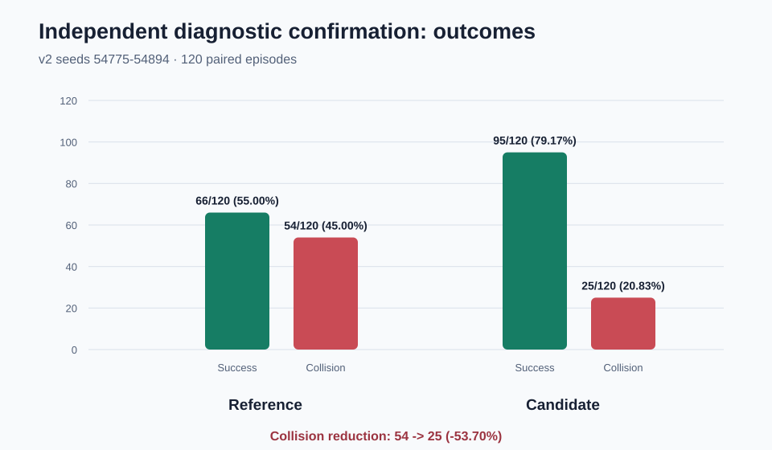
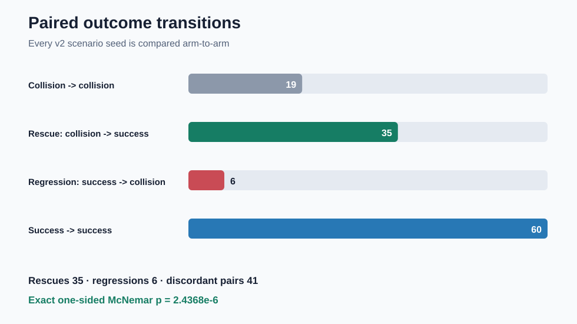
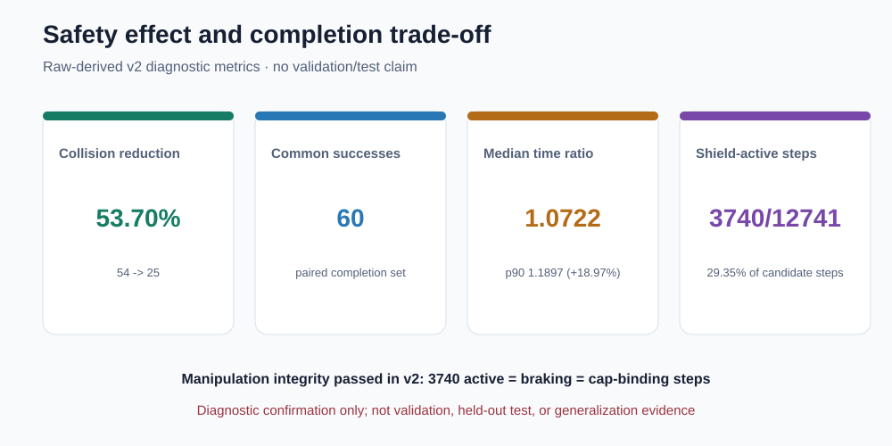

# Webots 前向制动：v1 审计到 v2 独立确认（公开版）

> **结论边界：**密封 v1 结果仍是 **`invalid_manipulation`**，离线审计只定位并修正了 checker
> 对一个 float32 边界步的判定方式，**没有改写 v1、也没有把 v1 的效果结果升级为有效结论**。
> 随后在全新且不重叠的 `54775～54894` 种子上完成 v2；v2 的预注册门槛全部通过，因此得到
> **独立 diagnostic 确认**。这不是 validation、held-out test 或跨场景泛化结论，也没有合并 v1/v2。

## 1. 为什么需要 v2

v1 使用 `25728～25847` 的 120 个配对回合，主效果门槛本身通过，但完整报告因 manipulation
完整性检查失败而封存为 `invalid_manipulation`。后验审计发现唯一差异来自 seed `25737`、step `21`：
实际送入控制链的 float32 动作变化为 `1.013278961e-6`，超过 `1e-6` 介入阈值并与速度上限的
float32 表示一致；旧 checker 却再次用 double 精度上限计算出 `9.985105547e-7`，漏计了这一个
cap-binding 步。因此审计把 v1 的 `3197/3197/3196` 解释为 checker 数值边界，而不是执行动作偏离。

审计的权限仅到“允许开展一次新的独立 diagnostic 确认”。v1 报告状态保持不变；v2 明确禁止
重跑 v1、重写或重新解释 v1、参数扫描、自适应扩样，以及 v1/v2 pooling fallback。

证据入口：[`v1 paired report`](../../artifacts/results/webots_front_brake_paired_diagnostic_v1/paired_diagnostic_report.json) →
[`offline boundary audit`](../../artifacts/results/webots_front_brake_v1_manipulation_reaudit_v1/manipulation_boundary_reaudit.json) →
[`independent v2 report`](../../artifacts/results/webots_front_brake_paired_confirmation_v2/paired_diagnostic_report.json)。

## 2. v2 结果：独立 diagnostic 确认通过

图表和下列数字均由 v2 两臂的原始 `episodes.csv` 重新计算，并与密封 JSON 报告逐项核对：



- reference：成功 **66/120（55.00%）**，碰撞 **54/120（45.00%）**；
- front-brake candidate：成功 **95/120（79.17%）**，碰撞 **25/120（20.83%）**；
- 碰撞数相对下降 **53.70%**（54 → 25）；
  两臂均无 timeout 或 error。

## 3. 配对证据



120 个相同 scenario seed 的结果转移为：19 个 collision→collision、**35 个 rescue**、
**6 个 regression**、60 个 success→success。成功端点的精确单侧 McNemar
`p = 2.43679915e-06`（约 `2.4368e-6`），通过预注册的 `< 0.05` 门槛。
该检验只回答这组新 diagnostic 场景中候选闭环 profile 是否优于 reference，不外推到未运行分布。

## 4. 安全收益与完成时间代价



- 共同成功样本为 **60** 个；逐 seed 候选/reference 完成时间比的中位数为
  **1.0722**，即共同成功回合的典型比例约增加 7.22%，仍低于
  预注册上限 1.15；第 90 百分位为 **1.1897**（约增加 18.97%）。
  p90 只作尾部代价的描述性披露，不属于、也不改变预注册的 median 门槛；
- candidate 的原始 shield sidecar 共记录 **3740/12741** 个 active steps
  （29.35%）；v2 中 active、braking、speed-cap-binding 均为 3740，
  角速度动作保持不变；
- v2 manipulation integrity、主效果 gate 和 overall gate 均为 `passed`。这里报告的是
  `front-brake enabled` 整个闭环 profile 的 intent-to-treat 效果，不把相关性表述为单步因果机制。

## 5. 严格边界

- **v1 仍无效：**离线审计不能追认 v1 主效果，也没有修改其 JSON/YAML/sidecar；
- **v2 独立而不合并：**v2 种子与 v1 不重叠，唯一主推断来自 v2 overall，未做 pooled fallback；
- **只属 diagnostic：**validation 与 held-out test 均未访问；这不能证明跨地图、跨障碍数量、
  真实机器人
  或其他模型上的泛化；
- **不用于 checkpoint 选择：**本报告没有训练、筛选或替换模型，也没有运行 Webots。

## 6. 可审计来源

生成器首先验证三组密封 JSON/YAML/`.sha256`，再验证 v2 两臂各四个 raw artifacts 的路径和
SHA-256；随后从 raw CSV/JSONL 重算结果、配对转移、完成时间比例与 shield-active 计数。任一输入
字节、路径、范围或诊断边界变化都会拒绝生成。

| 输入 | SHA-256 |
|---|---|
| `artifacts/results/webots_diagnostic_front_brake_v2_candidate_seed11/episode_context.jsonl` | `c42cbb2b5f3383ff56d76fee80adeb0e28f2d285f93fd179451b100d48dc41c4` |
| `artifacts/results/webots_diagnostic_front_brake_v2_candidate_seed11/episodes.csv` | `b35daccaddd6fdbb693d090f1b8d0de17a6e2bc3318272a689586732a0502643` |
| `artifacts/results/webots_diagnostic_front_brake_v2_candidate_seed11/shield_evidence.jsonl` | `f3e2d822c339ae3123f750db5253f30e21df511a00221944d583d5a2aadf3f7a` |
| `artifacts/results/webots_diagnostic_front_brake_v2_candidate_seed11/summary.json` | `38867d29a074a15ef6e0fa10fd028a58cf7ebf2b7f4da4983b6035145970ec91` |
| `artifacts/results/webots_diagnostic_front_brake_v2_reference_seed11/episode_context.jsonl` | `fa0ee4cb70e5377ba138ea26595fcec783c1a317aeaa79b318e21c8c23f5e157` |
| `artifacts/results/webots_diagnostic_front_brake_v2_reference_seed11/episodes.csv` | `e9c6f0d92d561f0d374baf446106c394b577cc165c58bc61c43077be01b3dad3` |
| `artifacts/results/webots_diagnostic_front_brake_v2_reference_seed11/shield_evidence.jsonl` | `247540a73ced04b1a0c4c5075c3ff0a85a9bd11c43fb25334e0c61cd89b1879b` |
| `artifacts/results/webots_diagnostic_front_brake_v2_reference_seed11/summary.json` | `5153fb51ec749f205ed6e21615e68f3674f9946b93c65b7fda68305652d5e210` |
| `artifacts/results/webots_front_brake_paired_confirmation_v2/paired_diagnostic_report.json` | `62397f5ffa892183dcca24438ea8c5de98c32adb7dcacad13fde47291cbe23d0` |
| `artifacts/results/webots_front_brake_paired_confirmation_v2/paired_diagnostic_report.sha256` | `fdff954b34eb2f3b0bedc01cf2ac652ce74967dca84e13c593372d70e0923890` |
| `artifacts/results/webots_front_brake_paired_confirmation_v2/paired_diagnostic_report.yaml` | `cb51dc6d0d2ddb43c1d129476596988dbc37d695fd613ebe2ba599360dbe3309` |
| `artifacts/results/webots_front_brake_paired_diagnostic_v1/paired_diagnostic_report.json` | `2779e8dcb6f8ccf2216464e196dc5c5f3a5ba1c8092eb0d75cb14fb62e2cc787` |
| `artifacts/results/webots_front_brake_paired_diagnostic_v1/paired_diagnostic_report.sha256` | `b255ab30a0bb0214dbaa4dd7a1b52eab02dcac441683eb6d4f3ef071a17b1427` |
| `artifacts/results/webots_front_brake_paired_diagnostic_v1/paired_diagnostic_report.yaml` | `db161fa425e25255381b60d99aece212b072fdbfa87061532e4f2a3f9289ff75` |
| `artifacts/results/webots_front_brake_v1_manipulation_reaudit_v1/manipulation_boundary_reaudit.json` | `aac1bf62e755a1868837c294adc4e2d13cf9949a4dcba484d0c0b18c4ffd16ed` |
| `artifacts/results/webots_front_brake_v1_manipulation_reaudit_v1/manipulation_boundary_reaudit.sha256` | `75f36c1c73b5686b8319b4d1134a622ebee67d59532f428f628bfe911e8d6379` |
| `artifacts/results/webots_front_brake_v1_manipulation_reaudit_v1/manipulation_boundary_reaudit.yaml` | `deb53cd3cd16c8a89cba5d26cf627d79fd4b04d7f9ad71a8d05e067f19d391e2` |

生成脚本：`scripts/generate_webots_front_brake_confirmation_report.py`
脚本 SHA-256：`a4184919b947a91d25c87c8425c46d935a4467a4bd2bd404c99a2dd47597fded`

## 7. 离线复现

以下命令只刷新这个已知的派生展示目录；它不会运行 Webots，也不会修改上述输入：

```bash
python scripts/generate_webots_front_brake_confirmation_report.py --force
```

默认不允许覆盖已有目录；`--force` 也只接受恰好包含本报告五个已知派生文件的目录。输出
`confirmation_report.sha256` 同时绑定 Markdown、3 张 SVG、生成脚本和全部直接输入。
