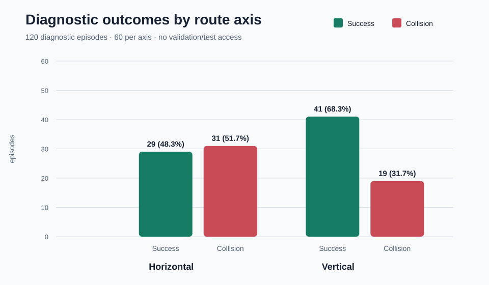
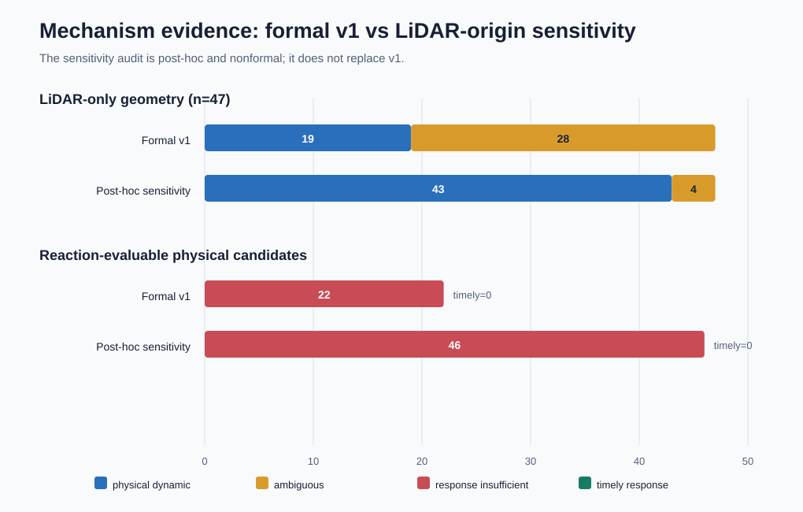
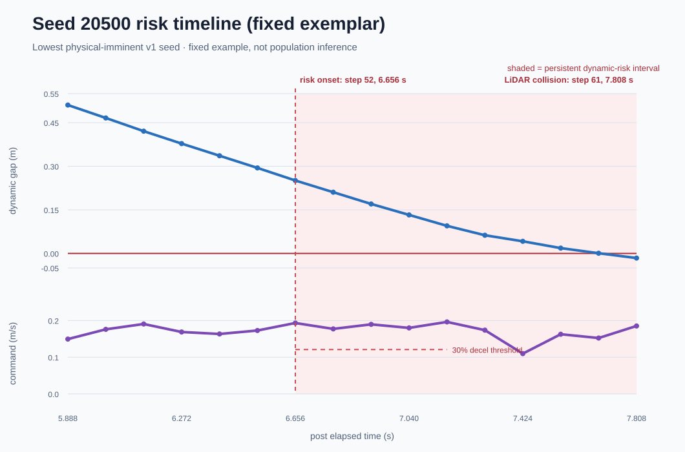

# Webots 动态避障风险诊断（公开版）

> **结论边界：**本页只报告固定 `20494～20613` 的 120 个 **diagnostic** 回合。正式 v1
> 机制判定是 **`indeterminate`（证据不足，无法定论）**。LiDAR 原点敏感性分析是
> **post-hoc / nonformal** 审计，只用于解释测量原点带来的归因变化，**不替代 v1 正式判定**。
> 本阶段未访问 validation seeds 或 held-out test seeds，也没有据此选择 checkpoint。

## 1. 目标与范围

该诊断回答的是：“当前 recovery-v1 策略的碰撞，更像是 LiDAR 阈值代理误触发，还是动态障碍
近碰与短时响应不足？”它不是最终性能评测。数据固定为 120 回合，水平/垂直路线各 60 回合，
模型 SHA-256 为 `c5e7c3de42c7664477097b2734975660fec840ad5b7f45425098158c27cb7275`。采集状态为 `collection_complete`；checkpoint selection、
validation/test access 均被协议禁止。



- 水平路线：成功 29/60（48.3%），碰撞
  31/60（51.7%）。
- 垂直路线：成功 41/60（68.3%），碰撞
  19/60（31.7%）。
- 合计：成功 70/120（58.3%），碰撞 50/120（41.7%）。这些比例仅描述 diagnostic 分布。

## 2. 正式 v1 判定：indeterminate

正式 `relative_motion_cpa_v1` 分析在 47 个 LiDAR-only 碰撞中，仅能把
19 个唯一归因为 physical dynamic geometry，另有
28 个无法唯一归因（歧义率
59.6%）。协议要求至少 24 个可分类失败且歧义率不高于 25%；
因此几何层不能通过门槛，正式结论保持 `indeterminate`。

响应层有 22 个可评估 physical candidates：
0 个在 0.512 s 窗口内达到 30% 减速，22
个呈现 short-horizon response-insufficient signature。但样本数仍低于预注册门槛 24，不能单独把
总体机制定论为“响应不足”。



## 3. LiDAR 原点敏感性：只能作为后验解释

R2025a TurtleBot3 Burger 的 extension slot 在机器人坐标系中有 `[-0.03, 0.0] m` 平移。
敏感性审计用同一 extension slot 的 GPS 记录位置作为 LiDAR 原点代理，重新计算终止帧射线与动态
障碍圆的交点残差；它**没有新记录真实 LiDAR node pose**。这是对固定数据的后验重算，未运行
Webots，formal mechanism inference 明确为 `false`。

- v1 的 28 个 ambiguous LiDAR-only 回合中，
  25 个因 GPS/LiDAR 代理原点获得唯一归因，
  另 3 个在两种原点下都未解析；
- 代理原点下最终有 43 个 physical、4 个 ambiguous、0 个 proxy-compatible。第 4 个
  ambiguous 是 seed `20523`：它虽获得唯一归因，但几何量落在 proxy tolerance band 内，
  所以没有被改写为 physical；
- 加上 3 个 contact-confirmed，共 46 个响应可评估候选；
  0 个 timely deceleration，46 个为
  response-insufficient signature。

沿用 v1 阈值会得到
`dynamic_short_horizon_response_insufficient_under_sensitivity_only_rule`，但这仍是
**sensitivity-only outcome，不是正式机制结论**。下一步若要升级证据，应在新协议中直接记录 LiDAR
节点世界坐标并预先锁定判定规则，而不是把本次后验结果改名为正式结论。

## 4. 固定轨迹示例：seed 20500

seed `20500` 是 v1 中被归为 `physical_imminent_dynamic` 的**最小 scenario seed**，因此按固定规则
选为可视化示例；它不代表平均回合，也不用于总体推断。该水平路线回合以 LiDAR-only collision
结束。持续动态风险从 step 52（6.656 s）开始，step 61（7.808 s）触发终止，
间隔 1.152 s。正式响应窗口内未检测到达到阈值的减速。



图中上半部分是动态障碍表面间隙（`dynamic_gap_m`），下半部分是该控制区间的线速度命令。
红色阴影仅标出该回合的 persistent dynamic-risk 区间；虚线阈值只对应 v1 的 30% 减速规则。

## 5. 证据哈希

生成器在出图前逐一复核以下直接输入，并交叉核对 CSV/JSON 的 120 个 episode、seed、路线方向、
结果和机制分类。任何字节变化都会拒绝生成。

| 直接输入 | 相对链接 | SHA-256 |
|---|---|---|
| formal v1 analysis report | [`risk_analysis_report.json`](../../artifacts/results/webots_recovery_v1_risk_analysis_v1/risk_analysis_report.json) | `ff560bb2c4d3ef8df3e180c6d117e6ce324b306493fb900af7fdd65ac68c2e50` |
| per-episode metrics JSON | [`risk_episode_metrics.json`](../../artifacts/results/webots_recovery_v1_risk_analysis_v1/risk_episode_metrics.json) | `7671e26fed44813f9594c6445e9ff0fb3a3e6c489b8b2a7db151f65c16e3fb73` |
| per-episode metrics CSV | [`risk_episode_metrics.csv`](../../artifacts/results/webots_recovery_v1_risk_analysis_v1/risk_episode_metrics.csv) | `0487ebc927d63b1de3f53035f4e94b3a19cd26cb4ab9f51d3237af92dcdc056b` |
| LiDAR-origin sensitivity report | [`lidar_origin_sensitivity_report.json`](../../artifacts/results/webots_recovery_v1_lidar_origin_sensitivity_v1/lidar_origin_sensitivity_report.json) | `88cedc14df9b72b53ecf2948e68a891a95dc3b38aeaf2fea8a45d6d653e3acbd` |
| LiDAR-origin per-episode JSON | [`lidar_origin_sensitivity_per_episode.json`](../../artifacts/results/webots_recovery_v1_lidar_origin_sensitivity_v1/lidar_origin_sensitivity_per_episode.json) | `6444d16b72cd47430b90a07ad20803abbfb1ee061986d987542b67fefba758ec` |

上游绑定：collection report `bb3e08bb20cb7d67b099323b37e3e15413d075be1b2b59fa9c95afb0317fd2cb`；episode context `fe68fe80c94be7c1c8ccedb75e54435b897c1e16c9305b8ac7c75e412814ed3f`；
episodes CSV `1665d9441ef6c28ab8a256aab22f54b4c75b7ac304d37bb902b37d4865c1c5a1`；model `c5e7c3de42c7664477097b2734975660fec840ad5b7f45425098158c27cb7275`。

## 6. 复现命令

以下命令均在仓库根目录运行。前两条分别重算正式分析和后验敏感性；使用新的输出目录，避免覆盖
锁定证据。第三条只读取锁定产物并生成本页与 SVG，**不会启动 Webots**。

```bash
COLLECTION=artifacts/results/webots_recovery_v1_risk_trajectory_v1/collection_report.json
V1=artifacts/results/webots_recovery_v1_risk_analysis_v1/risk_analysis_report.json
python scripts/analyze_webots_risk_trajectory.py \
  --collection-report "$COLLECTION" \
  --output-dir artifacts/results/reproduced_risk_analysis
python scripts/audit_webots_lidar_origin_sensitivity.py \
  --collection-report "$COLLECTION" \
  --v1-risk-analysis-report "$V1" \
  --output-dir artifacts/results/reproduced_lidar_origin_sensitivity
python scripts/generate_webots_risk_diagnostic_report.py
```

正式 v1 的公开数据入口为 [`risk_analysis_report.json`](../../artifacts/results/webots_recovery_v1_risk_analysis_v1/risk_analysis_report.json)；后验敏感性入口为
[`lidar_origin_sensitivity_report.json`](../../artifacts/results/webots_recovery_v1_lidar_origin_sensitivity_v1/lidar_origin_sensitivity_report.json)。本页只做可审计展示，不修改任何实验产物。
